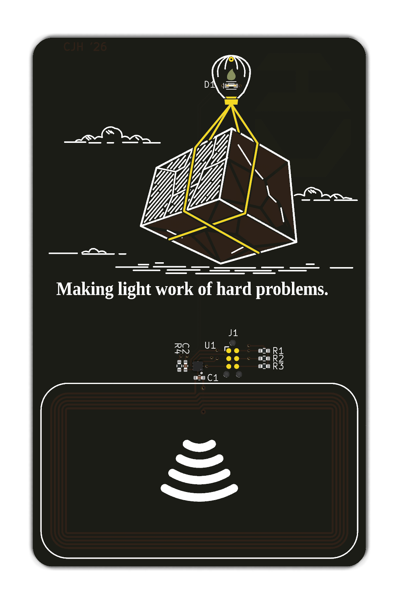
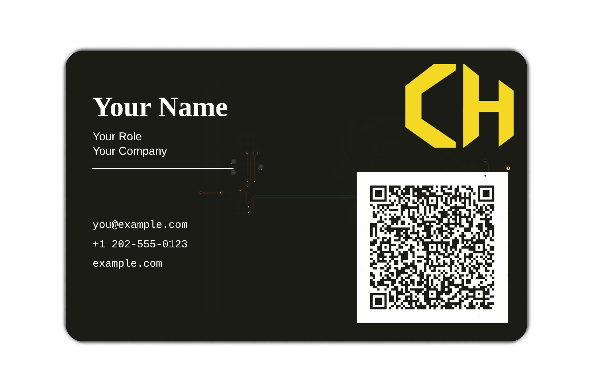
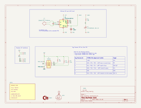

# PCB Business Card

A thin, wallet-size PCB business card combining printed contact details, a vCard
QR code, custom copper and silkscreen artwork, and passive NFC.

  
  

*KiCad 3D renders of the front and back, with gold on exposed copper.*

## Schematic

The design uses an NXP NT3H2111W0FHKH (NTAG I2C Plus) and a printed antenna for
tap-to-share contact information. It is designed to harvest energy from the NFC
reader's field to illuminate an LED, with no onboard battery or microcontroller.

## Project files

Open [business-card.kicad_pro](business-card.kicad_pro) in **KiCad 10** to explore
the design:

- [business-card.kicad_sch](business-card.kicad_sch) — circuit schematic.
- [business-card.kicad_pcb](business-card.kicad_pcb) — PCB layout.
- [business-card.kicad_sym](business-card.kicad_sym) — project symbols.
- [business-card.pretty/](business-card.pretty/) — project footprints.
- [business-card.3dshapes/](business-card.3dshapes/) — project 3D models.
- [artwork/](artwork/) — SVG artwork and previews used to generate footprints.

If adapting the card, replace the printed contact details, QR payload, and NFC
contents with your own.
Antenna tuning, NFC read range, and LED brightness require validation on
assembled hardware.
